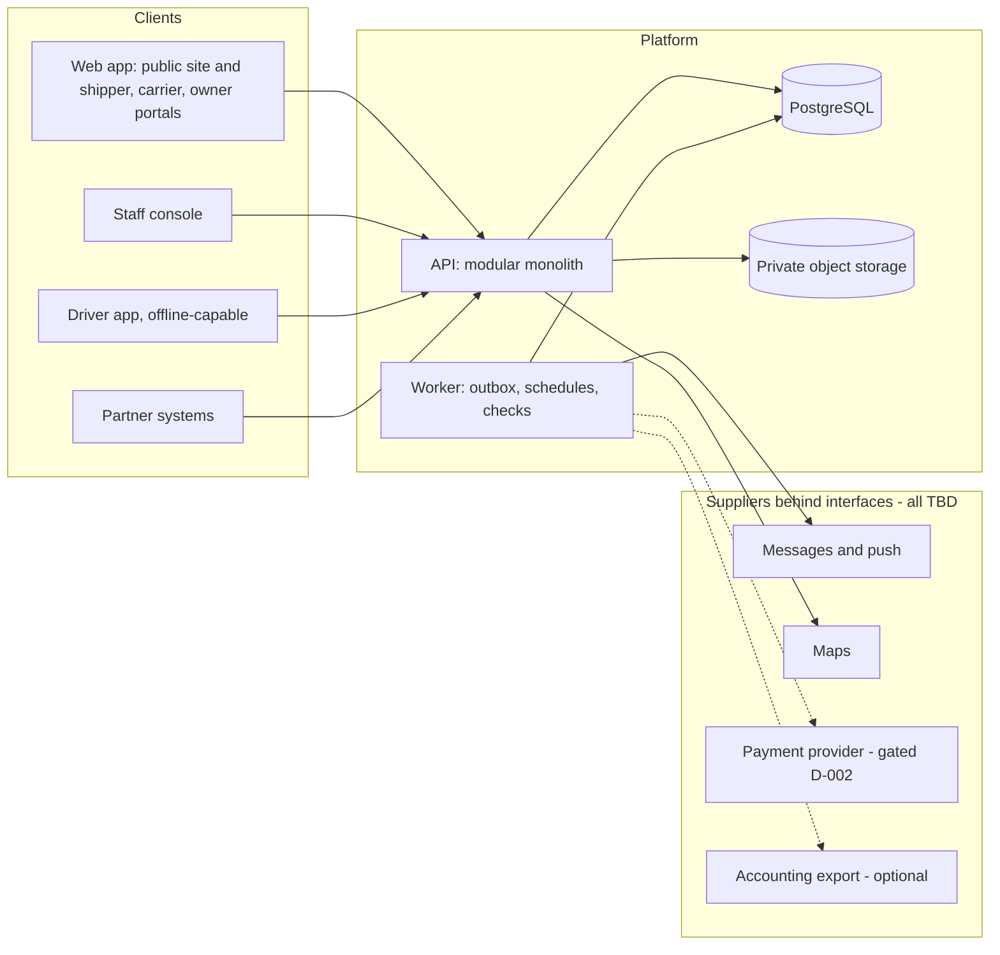

# Trucker — Stage 3: architecture evaluation (provisional)

Version 0.4, 13 Nov 2026. Owner: Abdullah. Changes in 0.4: stale progress line in section 12 corrected. Changes in 0.3: status distinguishes the working foundation from unimplemented business features; T-007 accepted with limits. Changes in 0.2: T-001 to T-006 accepted with conditions (section 13); the rigid dependency chain is replaced by orchestration interfaces and a shared-transaction rule (section 3); resource release is modelled as occupancy episodes (section 4); worker leases specified (section 8); foundation slice 1 recorded (section 12). Builds on the Stage 1 baseline and Stage 2 Parts 1 to 4. Authoritative copy: `docs/specs` in the repository; Claude-project copies are synchronised references.

**Status.** The architecture is a recommendation under review. **Implemented and tested:** foundation slice 1 only (workspace, configuration, health and readiness, migration runner; evidence in `docs/delivery/FOUNDATION_SLICE_1.md`). **Not implemented:** every business feature and every module in section 3 other than the configuration, database and migration parts of `platform`. No supplier is selected. D-001 (commercial model), D-002 (payment approach) and D-003 (launch geography) remain **TBD**, and so do the approved rules listed in Stage 2. This document gives **one** recommended architecture. It does not design competing commercial models: gated areas are named, given a boundary, and left empty. Library versions are pinned exactly in the lockfile; Node.js and PostgreSQL are major-version selections (see the evidence record). No legal, security or privacy compliance is asserted.

## 1. Evaluation of the reference direction

| Reference element | Verdict | Reason | Condition or change |
|---|---|---|---|
| NestJS TypeScript modular monolith | Keep | One deployable API with enforced module boundaries fits a small team and a transactional domain | Boundaries in section 3 are checked by a lint rule, not by convention |
| PostgreSQL | Keep | Reservation overlap, one-trip-per-resource, single commercial controller, proposer-not-approver and event uniqueness are all database constraints in Stage 2 | SQL-first migrations so those constraints are written exactly |
| PostGIS | Keep, used late | Needed only for distance, geofence and position queries in tracking | Extension enabled from the start; nothing depends on it until the tracking slice |
| Background jobs and transactional outbox | Keep the outbox; **change the queue** | The outbox is required for all-or-nothing booking and reliable notifications | Run jobs from PostgreSQL first (outbox table plus a worker process). Add Redis and a queue library only when measured load or a specific feature needs them: one fewer deployment unit |
| Next.js responsive website and portals | Keep, **as two applications** | Public site and participant portals share visitors, language and design | Staff console is a separate application with its own sign-in, mandatory MFA and network restrictions, so a fault in the public application cannot expose staff functions |
| Flutter mobile | Keep, driver application first | Offline queue, camera and background location need a native client | Other native applications remain in the target; their timing is D-004 |
| Private object storage | Keep | Documents, POD files and dispute evidence must never be public | Behind an interface; supplier TBD (D-011) |
| Authenticated real-time events | Defer until the tracking slice | Nothing before live tracking and trip messaging needs it | Polling and push notifications first; then one gateway inside the API process |
| Microservices, event streaming platforms, separate search engine | Not adopted | No confirmed requirement justifies them | Revisit only on evidence |

## 2. Recommended architecture in one view

Six deployment units: API, worker, web application, staff console, PostgreSQL, object storage. The driver application is distributed through the stores. Suppliers sit behind interfaces and are all TBD.

The worker is the same codebase as the API started in a different mode, so there is one build and one set of modules.

## 3. Modules and responsibility boundaries

Rules for every module: it owns its tables and nobody else reads or writes them; other modules call its published service interface; effects that must follow a saved change are emitted through the outbox; a module never calls a supplier directly, only a platform port.

| Module | Owns | Gate |
|---|---|---|
| **platform** | Configuration, database access, migrations, audit log, outbox, idempotency store, file storage port, notification port, clock, error format | None |
| **identity** | Users, sessions, device installations, staff accounts, MFA, recovery | Sign-in identifiers (Q-101) |
| **organisations** | Organisations, capabilities, memberships, invitations, API clients | None |
| **catalogue** | Countries, currencies and their precision, time zones, equipment and cargo types, document types | Content: D-003, D-006 |
| **verification** | Documents, review decisions, expiry | Document list needs legal review |
| **assets** | Trucks, trailers, driver profiles, ownership, delegation, affiliation, driver authorisation, ownership claims | Multi-affiliation rule (Q-102) |
| **shipments** | Shipment drafts, versions, publication | None for mechanics |
| **quotations** | Quotations, versions, availability flag | **D-001, D-005** |
| **bookings** | Bookings, terms snapshot, substitutions, cancellations before dispatch | **D-001**; P-201, P-204, P-205, P-207 |
| **reservations** | Time-based reservations, occupancy, resource-release records, consistency check | Mechanism: none. Release rule: DI-403 |
| **dispatch** | Assignments, dispatch authorisations | R-301 |
| **trips** | Trip state, event streams, late observations, reconciliation | None for mechanics |
| **tracking** | Location consent, positions, tracking links | R-303, R-304, R-305 |
| **messaging** | Trip threads, operations channel | R-305 |
| **interventions** | Exceptions, intervention cases, custody records | R-302, R-406 |
| **pod** | POD versions, manifests, review | R-401, R-402; DI-402, DI-404, DI-405 |
| **disputes** | Disputes, evidence, decisions, appeals, settlement hold records, adjustment records | R-403 to R-407; DI-401 |
| **settings** | Versioned settings, two-person approval | Which settings exist follows the approved rules |
| **integrations** | Partner webhooks, delivery log, sandbox | D-004 for a dedicated portal |
| **finance** | **Empty boundary.** Obligations, provider events, reconciliation, accounting export | **D-001, D-002, D-008**. Not designed |

### 3.1 How modules work together

The earlier single dependency chain is withdrawn. Modules are of two kinds.

| Kind | Rule |
|---|---|
| **Domain module** | Owns its tables and constraints and is the only code that writes SQL against them. Publishes **commands** (changes) and **queries** (reads) |
| **Orchestrator** | Owns no tables. Carries out one business operation that spans several domain modules by calling their commands in a fixed order |

Dependency rules, checked by a lint rule over the import graph against a reviewed list of allowed edges:

1. Every module may use `platform` and `catalogue`.
2. A domain module never calls another domain module's commands.
3. A domain module may call another module's published queries only where that edge is listed.
4. Changes that span modules happen only in an orchestrator.
5. Anything that should follow a saved change, but need not be part of it, is an outbox message handled after commit.
6. No cycles.

### 3.2 One atomic transaction across modules

Ownership means who writes the SQL and defines the constraints. It does not mean who opens the transaction.

| Rule | Detail |
|---|---|
| Unit of work | `platform` provides it. The orchestrator opens one database transaction and receives a transaction handle |
| Module commands | Every command takes the transaction handle, runs only its own module's SQL on its own tables, and never commits or rolls back |
| Commit | Only the unit of work commits, after every command has returned. Any failure rolls back everything, including outbox messages and the idempotency record written in the same transaction |
| Lock order | Fixed and documented per orchestrator, so two operations cannot deadlock by locking in opposite orders |
| Retries | An orchestrator is retried only as a whole, under one idempotency key |
| Tests | Each orchestrator has a real-database test that forces a failure at every step and asserts that nothing from any module remains |

Example, **gated on D-001 and not built**: accepting a quotation. The orchestrator locks the shipment (`shipments`), marks the quotation accepted (`quotations`), creates the booking (`bookings`), reserves truck, trailer and driver in identifier order (`reservations`), closes the other quotations (`quotations`) and enqueues notifications (`platform`). The reservation constraint lives in `reservations`; the booking row lives in `bookings`; both are saved or neither is.

Orchestrators foreseen (names only; each is specified with its slice): accept quotation [D-001]; cancel booking; apply substitution; start trip (dispatch, trips, reservations); close trip and release resources (trips, interventions, reservations); suspend a party or resource (identity, organisations, assets, dispatch, interventions).

## 4. Core data relationships

Entity names are provisional. "Constraint" means enforced by the database.

| Group | Entities and relationships | Constraints |
|---|---|---|
| Identity | user 1—n session; user 1—n device_installation; staff_account 1—n privilege_grant | One account per identifier |
| Organisations | organisation 1—n capability; organisation n—n user through membership; organisation 1—n api_client | At least one active admin |
| Assets | asset (truck or trailer) n—1 owning organisation through ownership; asset 1—n delegation; driver_profile 1—1 user; driver_profile n—n organisation through affiliation; driver_profile n—n asset through driver_authorisation; asset 1—n ownership_claim | No two active commercial-control delegations on one asset for overlapping periods |
| Verification | document n—1 subject (organisation, asset or driver_profile); document 1—n review_decision | Files private; decisions append-only |
| Demand | shipment 1—n shipment_version; shipment n—1 organisation; location carries its time zone | — |
| Offers (gated) | quotation n—1 shipment_version; quotation 1—n quotation_version | One open quotation per organisation per shipment |
| Booking | booking 1—1 accepted quotation_version; booking 1—1 terms_snapshot; booking 1—n substitution_proposal; booking 1—n cancellation_record | Agreed amount and snapshot cannot be updated. Party structure is **gated on D-001**: the booking table is not created until then |
| Reservation and occupancy | reservation n—1 booking, n—1 resource. occupancy_episode n—1 trip, n—1 resource: opened when a resource starts carrying out the trip (at trip start, or when a substitution takes effect during it) and closed by a release record stating the release condition (DI-403). A trip can have several episodes for the same kind of resource, and a resource can have more than one episode on a trip | No overlapping active reservations per resource; **at most one open occupancy episode per resource**; an episode cannot close without a release record |
| Dispatch | assignment n—1 booking, n—1 driver_profile; dispatch_authorisation n—1 booking, holding the facts checked | One usable authorisation per booking |
| Trip | trip 1—1 booking; event_stream n—1 trip (one per assignment and device installation, plus console); trip_event n—1 event_stream; reconciliation_entry n—n trip_event | Event identifier unique for ever; sequence unique within a stream; events never updated or deleted |
| Tracking | location_consent n—1 driver_profile; position n—1 trip, with source | No position without a granted consent at capture and at receipt |
| Evidence | pod_version n—1 trip; pod_manifest 1—1 pod_version; pod_item n—1 pod_manifest; pod_review n—1 pod_version; custody_record n—1 trip | A POD version cannot be accepted while a required manifest item is missing (DI-402) |
| Disputes | dispute n—1 booking; evidence_submission n—1 dispute; decision n—1 dispute; **settlement_hold n—1 booking, owned by exactly one dispute or intervention case** (DI-401); adjustment_record n—1 decision | A hold is released only through its owner; adjustment proposer and approver differ |
| Cross-cutting | audit_event; outbox_message; idempotency_record; setting_version with proposal and approval | Audit is append-only; idempotency key unique per organisation, caller and operation; setting approver differs from proposer |

Representation rules:
- Every tenant-owned row carries its organisation; rows shared by two organisations (a booking) carry both.
- Money is an integer number of minor units plus a currency code; precision comes from the currency table. No floating-point amounts anywhere.
- Every moment is stored as an absolute instant; local time is derived from the location's time zone.
- Country, currency and time zone are on organisation, location and booking from the first migration, so one country or several is a matter of catalogue rows (D-003).
- The terms snapshot is a versioned document with a schema version. Its **content** is gated; its immutability is not.

## 5. Permission enforcement

Enforcement is layered so that a mistake in one layer is caught by another.

| Layer | What it does |
|---|---|
| 1. Authentication | Resolves every request to a principal: user and session, or API client; with the organisation acting for, and staff privileges if any. Staff sign in only through the console, with MFA |
| 2. Policy | Every use case calls one policy function with principal, action and the specific record. Default is deny. Policies live in the owning module and are unit-tested as a table of role × action × relationship |
| 3. Data access | Repository functions require the tenant context and cannot be called without it |
| 4. Database | Row-level security on tenant-owned tables as a second barrier, using a per-transaction setting for the acting organisation. The application's database role cannot bypass it. Staff reads go through explicit, audited paths (technical decision T-001) |
| 5. Projections | What another organisation may see of a record (for example a published shipment) is a named read model with its own columns, never the base table |
| 6. Files | No public URLs. A short-lived signed link is issued only after the policy check for that file and that viewer; staff views are audited |
| 7. Live updates | Checked when subscribing and again on every message sent; subscriptions are closed when access ends |
| 8. Separation of duties | Proposer and approver differ for financial settings and adjustments, enforced by a database constraint as well as policy |
| 9. Responses | A record the caller may not see is reported as not found |

Verification: an automated negative test matrix (every role against every action it must not perform) runs in CI; tenant-isolation tests run against the real database, not mocks.

## 6. Offline synchronisation

| Part | Design |
|---|---|
| On the device | A local durable database holds the cached trip, an outbound queue of events (identifier, stream, sequence, recorded time, payload), queued messages and files with upload progress. Nothing is lost on restart |
| Stream | One per assignment and device installation; the device numbers its own events. The server registers the installation at sign-in |
| Upload | Batches to one endpoint. For each event the server: authenticates and authorises; discards a known event identifier as a duplicate; holds it if an earlier one in the stream is missing; otherwise locks the trip, tests the transition against current state, applies or stores it as a late observation, and writes audit and outbox entries in the same transaction |
| Answer | Per event: applied, duplicate, held, rejected with reason, or late observation. The device clears only what the server has answered |
| Download | The device asks for changes to its trips since a cursor and replaces its cached trip state with the server's. The server state always wins |
| Files | Uploaded separately and resumably against a manifest; the server reports which required items are still missing (DI-402) |
| Clocks | Device time is recorded, never trusted for deadlines; implausible times are flagged (Part 3, 5.3) |
| Consent | Enforced on the server at receipt as well as on the device at capture |
| Versions | The API states the oldest application version it accepts; an older application is told to update before it can upload, and its queue is preserved |
| Not promised | Exactly-once delivery over the network. Promised: each event identifier takes effect at most once |

Background location and notification behaviour differ between mobile operating systems and change between releases; they are to be verified against the platforms' current documentation before the tracking slice is specified in detail.

## 7. API conventions

| Topic | Convention |
|---|---|
| Style | JSON over HTTPS under a version prefix; a machine-readable contract is generated and published; clients are generated from it |
| Errors | One envelope: stable code, human message, details, request identifier |
| Retries | Idempotency key on every changing request, with the scope and order of checks in Part 2, 3.2 |
| Concurrency | Version number on mutable records; a stale write is refused |
| Lists | Cursor pagination; explicit sort |
| Values | Instants in UTC; amounts as minor units with currency; language chosen by header with EN, AR, UR message catalogues |
| Webhooks | Signed, timestamped, with a replay window; delivery log and manual replay in the console |
| Versioning | Additive changes within a version; breaking changes only in a new version with an announced overlap |
| Limits | Rate limits per caller and per sensitive operation (sign-in codes, uploads) |

## 8. Background work, observability and recovery

| Topic | Design |
|---|---|
| Outbox | A row written in the same transaction as the change. Consumers are idempotent |
| Worker leases | A worker claims a batch of rows by setting a lease owner and a lease expiry, without blocking other workers. It extends the lease while working and clears it on success |
| Crash recovery | A crashed worker's rows become claimable again when the lease expires; no manual step |
| Retries | Each failure increments an attempt count and sets the next attempt time with back-off. After a maximum the row is parked, visible to staff and replayable |
| Duplicate delivery | Delivery is at least once: a worker can crash after delivering and before recording success. Every message carries a stable identifier; consumers and partner webhooks de-duplicate on it |
| Schedules | Expiry of quotations, authorisations and documents; the reservation consistency check; reminder notices. One instance runs each job at a time |
| Logs and metrics | Structured logs with a request identifier and no secrets or personal documents; health and readiness endpoints; error and latency metrics; alerts on parked outbox rows and consistency findings |
| Audit | Append-only table; the application role has no update or delete right on it |
| Migrations | Forward-only, reviewed, applied by the pipeline; destructive changes in two releases (expand, then contract) |
| Backup and restore | Continuous backup with point-in-time recovery; a restore rehearsal is a release gate. Recovery objectives are **TBD** (D-012) |

## 9. Environments and secrets

| Environment | Purpose | Data | Status |
|---|---|---|---|
| Local | Development on one machine: API, worker, both web applications, database, storage emulator, fake message and maps adapters | Seeded, fictional | Can be built now |
| CI | Every change: lint, type check, unit tests, integration tests against a real database, migration check, build | Ephemeral | Can be built now |
| Staging | Production-like rehearsal, language review, acceptance | Synthetic only; never copies of production | Needs a hosting choice (D-011) |
| Production | Live service | Real | **Gated**: hosting, residency (D-003), suppliers, legal review, release gates |

Rules: configuration is validated at start and the process refuses to run with missing or malformed values; secrets come from the environment or a secret store and are never committed; development adapters refuse to start in production mode; each environment has its own credentials and storage; everything runs in containers so the hosting choice stays open.

## 10. Repository layout

One repository, so contracts and translations cannot drift between clients.

| Path | Contents |
|---|---|
| `apps/api` | API and worker (one codebase, two start modes) |
| `apps/web` | Public website and participant portals |
| `apps/console` | Staff console |
| `apps/driver` | Flutter driver application |
| `packages/contracts` | Generated API contract and clients |
| `packages/i18n` | EN, AR, UR message catalogues shared by web and console; exported for the driver application |
| `db/migrations` | SQL migrations |
| `tools/dev` | Local environment and helper scripts |
| `docs/specs`, `docs/delivery`, `docs/reference` | As in the housekeeping change |

## 11. What is gated

| Area | Buildable on your instruction | Waits for |
|---|---|---|
| Foundation (section 12, group F-A) | Yes | Nothing |
| Platform primitives (group F-B) | Yes | Nothing |
| Sign-in, organisations, verification, assets | Design ready | Q-101, first country, document list review, Q-102 |
| Shipments | Design ready | First country, D-006 |
| Reservation and occupancy mechanism | Design ready | DI-403 for the release rule |
| Quotations, bookings | **No** | D-001, D-005, Part 2 section 10 A |
| Dispatch, interventions | **No** | R-301, R-302 |
| Trip events and offline queue | Design ready | Nothing for mechanics |
| Tracking | **No** | R-303 to R-305, legal review |
| POD, disputes | **No** | R-401 to R-407, DI-401 to DI-405 |
| Finance, payment provider, accounting export | **No; not designed** | D-001, D-002, D-008 |
| Staging and production hosting | **No** | D-003, D-011 |

## 12. Foundation backlog

No estimates are given: delivery capacity is not yet known. Nothing here is started without your instruction.

**Progress.** Foundation slice 1 (instructed 13 Nov 2026) covers F-01, the configuration and health parts of F-03, F-04 without reference data, and the F-05 CI workflow. It was merged into the `staging` branch on 13 Nov 2026 after CI passed on GitHub; `main` is unchanged. Review fixes to it are tracked in the evidence record. Evidence: `docs/delivery/FOUNDATION_SLICE_1.md`. F-01 depends on no business or supplier decision. Only `apps/api` exists; no other application or module is scaffolded.

**F-A. Foundation only (repository structure, configuration, database connectivity, CI)**

| ID | Outcome | Changes | Tests and evidence | Done when |
|---|---|---|---|---|
| F-01 | The repository has the layout of section 10 and one command installs everything | Workspace configuration, formatting, lint and type-check setup, pinned tool versions, lockfiles committed | Clean clone installs and passes lint and type check | A second person reproduces it from the README |
| F-02 | A local environment starts with one command | Container definitions for database and storage emulator; scripts in `tools/dev`; example environment file with no secrets | Start, stop and reset scripts run on a clean machine | Documented and repeatable |
| F-03 | The API starts, validates its configuration and reports health | API skeleton; configuration schema; health and readiness endpoints; error envelope; request identifier | Unit tests for configuration validation; start refused on a missing value | Readiness is false when the database is unreachable |
| F-04 | The database is reachable and migrations run | Connection handling; migration runner; first migration (extensions, countries, currencies, time zones as empty or seed reference tables) | Integration test against a real database; migration applies to an empty database and is recorded | Migration check runs in CI |
| F-05 | Every change is checked automatically | CI pipeline: install, lint, type check, unit and integration tests with a database service, builds of each application | A deliberately failing test fails the pipeline | Pipeline required before merge |
| F-06 | Web, console and driver shells build and switch language and direction | Empty shells with EN, AR, UR catalogues, right-to-left layout switch, no business screens | Build in CI; a rendering test per language and direction | Three languages selectable in each shell |

**F-B. Decision-independent platform primitives (begin only on your instruction)**

| ID | Outcome | Tests and evidence |
|---|---|---|
| F-07 | Append-only audit log with a single writing interface | The application role cannot update or delete audit rows |
| F-08 | Outbox and worker loop with retry, parking and replay | A crashed delivery is retried once the worker restarts; a parked row is visible and replayable |
| F-09 | Idempotency store with the scope and order of checks in Part 2, 3.2 | Two simultaneous identical requests execute once; a rolled-back request leaves no stored outcome |
| F-10 | Tenant-isolation harness: row-level security spike and the negative test framework | A query without tenant context returns nothing; the matrix runner fails on a missing policy |
| F-11 | Integrity spike on throw-away tables: overlap exclusion and one-in-progress-per-resource under concurrent load | Concurrent conflicting inserts yield exactly one success. Proves the mechanism only; contains no booking logic |

## 13. Technical decisions

Accepted by Abdullah on 13 Nov 2026, each subject to the condition shown. The conditions become acceptance tests of the task that introduces the feature.

| ID | Decision | Status | Condition to prove |
|---|---|---|---|
| T-001 | Database row-level security as a second barrier | Accepted, after testing | The application connects as a role that does not own the tables and cannot bypass policies (owners normally bypass them unless the table forces row security: https://www.postgresql.org/docs/current/ddl-rowsecurity.html). Tests: tenant context is set per transaction and cannot leak to the next request on a pooled connection; rows shared by two organisations (bookings) are visible to both and to nobody else; staff and worker access use explicit, audited paths; a query with no tenant context returns nothing |
| T-002 | PostgreSQL-based jobs first | Accepted | Worker leases, crash recovery, retries and duplicate-delivery handling as specified in section 8, each with a test |
| T-003 | Separate staff application | Accepted | Staff permissions are enforced by the API for every request. A separate screen set is not treated as a security boundary |
| T-004 | SQL-first migrations | Accepted | Typed queries; migrations reviewed like code; constraints tested against a real database |
| T-005 | API contract generated from the code | Accepted | Compatibility check between the published contract and the previous one in CI; requests validated at run time by explicit validation, because generated documentation does not validate anything (https://docs.nestjs.com/openapi/cli-plugin) |
| T-006 | Live updates deferred | Accepted | Introduced with the tracking requirements |
| T-007 | Migration runner: small in-repository runner | Accepted for transactional SQL only | Unsupported operations documented and refused; files cannot control transactions; recovery after a terminated runner tested. See docs/delivery/FOUNDATION_SLICE_1.md |

## 14. Risks carried into implementation

| Risk | Mitigation |
|---|---|
| Gated modules get built on assumptions | Section 11 is the gate list; a gated module has no tables until its decision is recorded |
| Database constraints are bypassed by convenience code | Only the owning module writes its tables; constraints are tested under concurrency in CI |
| Offline logic diverges between device and server | Server is authoritative; one shared set of event and status definitions in the contract package |
| Suppliers chosen late force rework | Every supplier sits behind a port with a fake adapter and contract tests |
| Versions drift from what was evaluated | Versions pinned at F-01 against current vendor documentation and reviewed on a schedule |
